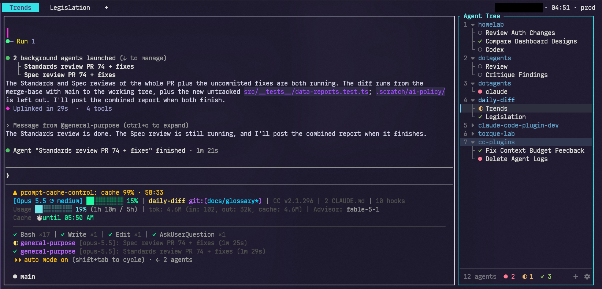

<div align="center">

# Agent Tree

**Every workspace and agent in herdr, as a live tree beside your work**



<a href="https://github.com/dboeter/herdr-agent-tree/releases"></a>
<a href="https://github.com/dboeter/herdr-agent-tree/actions/workflows/ci.yml"></a>

<a href="LICENSE"></a>

</div>

---

## What it is

A [herdr](https://herdr.dev) plugin that docks a narrow pane on the left (or right) edge
of every tab, showing your workspaces as groups and their agents as a live tree.

## Why

With agents spread over several workspaces and tabs, the one waiting on you is easy to
miss. The tree keeps all of them in view from whichever tab you are in: what each agent is
doing, which one needs you, and one keypress or click to jump there.

## What you get

- Status per agent: `●` blocked, `◐` working, `✓` done, `○` idle. A row flashes when its
  agent becomes blocked or done; a collapsed workspace flashes on its agents' behalf.
- `▍` at the left edge marks the agent in the tab you are looking at, and that workspace's name is
  at full colour; other workspaces are dimmed. The selection bar shows only while the tree has
  focus, or while its menu or a rename is open.
- An agent is named after its tab, so renaming the tab renames the row. Several agents in
  one tab add their session titles (`api · fix tests`); a tab with only a number for a
  label shows the session title alone.
- A folded workspace counts its blocked, working and done agents on its own row.
- The footer counts all agents, and how many are blocked, working or done ("all idle"
  when every agent is idle).

## Requirements

- herdr 0.9.0 or newer, on Linux (other platforms untested)
- `python3` 3.11 or newer on `PATH` (stdlib only, nothing to install)
- A [Nerd Font](https://www.nerdfonts.com) for the workspace carets and the footer's plus and settings cog

## Quick start

```sh
herdr plugin install dboeter/herdr-agent-tree
```

That is the whole install: the next tab you create or switch to gets a tree. Nothing
needs a restart.

To show or hide every tree with one key, add this to herdr's `config.toml` (`prefix` is
`ctrl+b` by default; pick any key that is free in your config). Use
`herdr-agent-tree.toggle` instead for the focused tab only:

```toml
[[keys.command]]
key = "prefix+shift+a"
type = "plugin_action"
command = "herdr-agent-tree.toggle-all"
description = "Toggle agent tree everywhere"
```

From a local clone instead of GitHub:

```sh
git clone https://github.com/dboeter/herdr-agent-tree
herdr plugin link ./herdr-agent-tree
```

Re-run `herdr plugin link` after editing `herdr-plugin.toml` so herdr reloads it. Edits
to `agent_tree.py` apply to trees opened afterwards. Run the tests with
`python3 -m unittest discover -s tests`.

### Or hand it to an agent

Paste this at a coding agent and it will do the install:

```text
Install the Agent Tree plugin for herdr on this machine.

1. Check that `python3 --version` is 3.11 or newer. If not, stop and tell me.
2. herdr plugin install dboeter/herdr-agent-tree
3. Check it took: `herdr plugin list` shows herdr-agent-tree as enabled.

Do NOT run `herdr server stop` and do not kill the herdr process: that ends
every program in every pane, including whatever is running you. Nothing here
needs a restart; a tree appears in the next tab I switch to.
```

## Usage

A tree docks itself into a tab whenever the tab is created or focused, as long as the
tab's tallest edge pane is at least 84 columns wide (`auto_dock_min_width`) and the tab
is not zoomed. Set `auto_dock = false` to only open trees with the toggle action.

| Key | Action |
|---|---|
| `j` `k` / `↓` `↑` / wheel | Move |
| `g` `G` | First / last row |
| `1`–`9` | Jump to workspace |
| `Enter` / `Space` / click | Focus the agent, or fold/unfold the workspace |
| click the plus in the footer | Create a workspace in this workspace's directory and switch to it |
| `n` | New menu: a workspace (as the plus), or a new agent or tab in the selected row's workspace |
| `h` `l` / `←` `→` | Fold / unfold; `h` on an agent jumps to its workspace |
| `r` | Rename the workspace, or the agent's tab (`Enter` saves, `Esc` cancels) |
| `c` `C` | Cycle the workspace colour |
| right-click | On an agent: focus, rename tab, fold workspace, cycle colour, close pane. On a workspace: fold/unfold, a new agent from the `New agent ›` submenu (hover, click or `→`), new tab, rename, cycle colour, close workspace. `Esc` or a click elsewhere closes the menu |
| `s` / click the cog in the footer | Settings menu: key hints, flash, default colour, auto-dock, dock side |
| `q` | Close the tree and keep this tab free of it |
| `Ctrl-C` | Quit the tree process only; auto-dock brings it back within about 20 s |

Plugin actions, available from herdr's action menu:

- **Toggle agent tree in this tab**: close the tree here and keep it closed, or bring it back.
- **Toggle agent tree everywhere**: flip `auto_dock`, the cog menu's Auto-dock. Off closes every tree; on docks one here and lifts every `q`.

Folded workspaces, colours and per-tab opt-outs are shared by all trees and persist in
`$HERDR_PLUGIN_STATE_DIR` (`~/.local/state/herdr/plugins/herdr-agent-tree`).

## Configuration

Settings live in `config.toml` in the plugin's config directory
(`herdr plugin config-dir herdr-agent-tree` prints it). Change them from the cog menu
(`s`) or edit the file. Every key is optional; these are the defaults:

```toml
side = "left"                # dock on the "left" or "right" edge
auto_dock = true             # false: trees only open with the toggle action
auto_dock_min_width = 84     # edge pane width (columns) a tab needs before a tree docks itself
workspace_color = "#7dcfff"  # default workspace colour; c/C still cycles the palette
flash = true                 # false stops rows flashing when an agent becomes blocked or done
hints = false                # true shows the tree's keys above the footer
agents = ["claude", "codex"]  # agents a workspace's right-click menu can start in a new tab
```

[`config.example.toml`](config.example.toml) explains each key, with the palette's
colours. The cog menu rewrites the file with its keys only, so comments in it are dropped.
Open trees pick up `workspace_color`, `flash`, `hints` and `agents` within a few seconds (up to 10 s in a hidden tab);
`auto_dock` and `auto_dock_min_width` apply from the next tab switch. `side`
applies to new trees; to move an open tree, toggle it off and on again.

## How it works

`agent_tree.py` is one script with several modes. Herdr runs `--ensure` on tab and
workspace events; it docks a tree into the focused tab unless a live one is already
there. Each tree is its own `--ui` process. It subscribes to herdr's event stream,
re-reads the session snapshot at most every 0.4 s on events (and every 3 s regardless),
and writes a heartbeat to its pane metadata every 8 s. A tree in a hidden tab ignores
pane updates and re-reads every 10 s instead. A tree whose heartbeat is older
than 20 s, such as one restored from a saved session without its process, is replaced
on the next focus.

## Troubleshooting

**No tree appears in a tab.** A tree only docks itself when the tab's tallest edge pane is
at least `auto_dock_min_width` (84) columns wide and the tab is not zoomed. It also stays
away from tabs you closed it in with `q`, and from every tab while `auto_dock = false`
(which **Toggle agent tree everywhere** sets). Run **Toggle agent tree in this tab** to dock one
by hand. If that fails too, read the hook logs:

```sh
herdr plugin log list --plugin herdr-agent-tree --limit 5
```

A `ModuleNotFoundError: No module named 'tomllib'` there means `python3` is older than 3.11.

**Boxes instead of the carets, plus and cog.** The terminal font is not a
[Nerd Font](https://www.nerdfonts.com). Install one and select it in your terminal.

**A pane titled "Agent Tree" shows a plain shell.** herdr restored a saved session, which
brings back the pane but not its process. The plugin replaces it the next time you focus
that tab.

**Colours look off on a light theme.** The palette and the flash fade are tuned for a dark
terminal background.

## Uninstall

Close every tree first with **Toggle agent tree everywhere**, then:

```sh
herdr plugin uninstall herdr-agent-tree
```

Settings and state stay behind in `$(herdr plugin config-dir herdr-agent-tree)` and
`~/.local/state/herdr/plugins/herdr-agent-tree`; delete those directories to remove them.

## License

[MIT](LICENSE). Changes per version are in [CHANGELOG.md](CHANGELOG.md).
